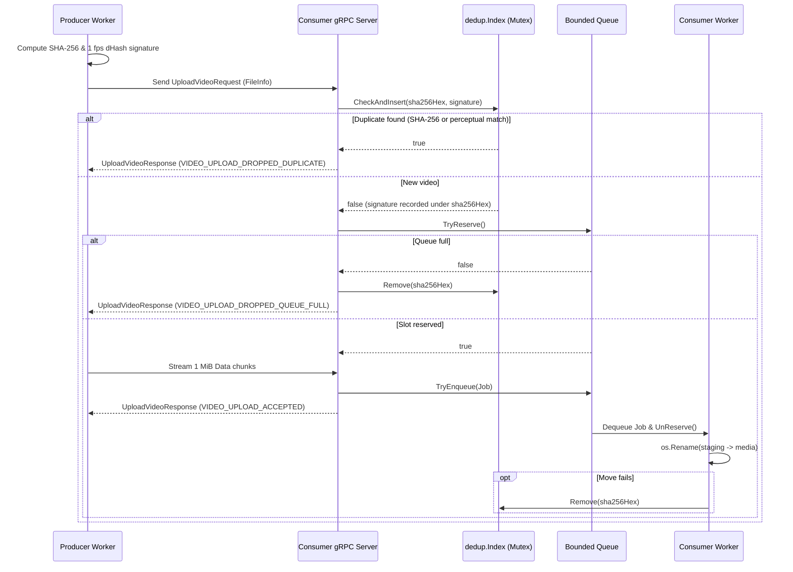

# Duplicate Detection

This document explains how duplicate video detection works across the **producer** and **consumer** in the media upload service.

---

## 1. Overview

Duplicate detection is designed around two goals:

1. **Catch both exact and re-encoded duplicates:**
   - **SHA-256 (`hash`)** catches files with identical bytes in $O(1)$ time.
   - **Perceptual video dHash (`signature`)** catches videos that were re-encoded, resized, compressed, or slightly trimmed, where the raw file bytes (and SHA-256) differ but the visual content is the same.
2. **Reject duplicates before streaming video data:**
   - The producer computes both hashes before opening the gRPC stream and sends them in the first message (`VideoUploadInfo`).
   - The consumer checks the duplicate index immediately upon receiving `VideoUploadInfo`. If the video is a duplicate, the consumer replies with `VIDEO_UPLOAD_DROPPED_DUPLICATE` and closes the stream before any 1 MiB video chunks are transferred.



---

## 2. Producer Side

### 2.1 Exact Byte Hash (`producer/video_hash/sha256.go`)

`videohash.SHA256(video *os.File)` streams the file through Go's standard `crypto/sha256` using an `io.SectionReader` starting at offset `0`. Using `io.NewSectionReader` avoids mutating the file descriptor's seek offset.

### 2.2 Perceptual Video Signature (`producer/video_hash/video_dhash.go`)

`videohash.VideoSignature(ctx, video)` computes a sequence of 64-bit difference hashes (**dHash**), one per second of video:

1. **Frame Extraction (`extractFrameRTI`):**
   `ffmpeg` samples the video at **1 frame per second**, scales each frame to **$9 \times 8$ pixels** using area averaging, converts it to 8-bit grayscale, and writes the raw pixels (`72` bytes per frame) to `stdout`:
   ```text
   ffmpeg -v error -i <file> -vf fps=1,scale=9:8:flags=area,format=gray -f rawvideo pipe:1
   ```
2. **64-bit Difference Hash (`dhash`):**
   Each $9 \times 8$ frame has 8 rows of 9 pixels. Within each row, every pixel at column `col` ($0 \le \text{col} < 8$) is compared to its right neighbor at `col + 1`:
   - Bit is `1` if `frame[row*9 + col] < frame[row*9 + col + 1]` (the right pixel is brighter).
   - Bit is `0` otherwise.

   This produces $8 \times 8 = 64$ bits (`uint64`) per frame. Because re-encoding or brightness shifts rarely change the relative brightness order of neighboring regions, a re-encoded video produces frame hashes with a small Hamming distance from the original.

### 2.3 Upload Flow & Early Rejection (`producer/upload/upload.go` & `producer/worker/worker.go`)

1. `upload.File` computes `hash` and `signature` **outside** the retry loop so transient connection retries (`codes.Unavailable`) do not re-run `ffmpeg` or re-hash the file.
2. `sendFile` sends `VideoUploadInfo` (containing `FileName`, `FileSize`, `ProducerId`, `Hash`, and `Signature`) as the first message on the stream, then streams the file in 1 MiB chunks.
3. If the consumer rejects the upload as `VIDEO_UPLOAD_DROPPED_DUPLICATE`, the consumer closes the stream immediately after `FileInfo`. On the producer side, `stream.Send` returns `io.EOF` (which `attemptUpload` ignores), and `stream.CloseAndRecv()` returns the `VIDEO_UPLOAD_DROPPED_DUPLICATE` status.
4. `ProducerWorker.run` logs the duplicate status at `WARN` level, increments `numDuplicate` in its `RunSummary`, and moves on to the next file without retrying.

---

## 3. Consumer Side

### 3.1 Perceptual Similarity (`consumer/dedup/similarity.go`)

The consumer compares two video signatures (`a, b []uint64`) in four steps:

1. **Frame Distance (`frameDistance`):**
   Computes the Hamming distance between two 64-bit frame hashes using `bits.OnesCount64(a ^ b)` (the number of bit positions that differ). Two frames are considered a visual match if their Hamming distance is at most `maxFrameDistance = 10` (out of 64 bits).
2. **Filtering Uninformative Frames (`isInformative`):**
   Solid or near-uniform frames (such as pure black fade-ins, fade-outs, or blank title cards) have almost identical adjacent pixels, which all hash to `0` (or near `0`, or near all `1`s for a uniform horizontal ramp). If these counted as matches, two unrelated videos that both contain black screens could falsely match.
   `isInformative(hash)` requires the number of `1` bits in `hash` to be between `minInformativeBits = 4` and `64 - minInformativeBits = 60`.
3. **Sliding-Window Alignment (`bestAlignment`):**
   Because a copy of a video may have slightly shifted frame sampling or trimmed start/end segments, `bestAlignment(a, b)` slides signature `b` across signature `a` over every valid relative time offset `-(len(b) - 1)` to `len(a) - 1`.
   At each offset, it counts how many overlapping frame pairs `(fa, fb)` satisfy:
   ```go
   isInformative(fa) && isInformative(fb) && frameDistance(fa, fb) <= maxFrameDistance
   ```
   and returns the maximum match count across all offsets. Offsets whose total overlap is `<= best` are skipped early.
4. **Duplicate Decision (`isDuplicate`):**
   `isDuplicate(a, b)` counts the number of informative frames `infA` and `infB` in each signature and checks whether the best alignment matches at least `minMatchRatio = 0.7` (70%) of `max(infA, infB)`:
   $$\frac{\text{bestAlignment}(a, b)}{\max(\text{infA}, \text{infB})} \ge 0.7$$
   Using `max(infA, infB)` ensures that:
   - Uninformative fade-in/fade-out frames do not penalize a valid match.
   - A very short clip cannot falsely match a much longer video.

### 3.2 Thread-Safe Duplicate Index (`consumer/dedup/index.go`)

`dedup.Index` holds a `map[string][]uint64` protected by a `sync.Mutex`:

- **`CheckAndInsert(id string, signature []uint64) bool`:**
  Locks `idx.mu` for the entire check-and-insert critical section so two concurrent uploads of the same video cannot both pass:
  1. Checks if `id` (the hex-encoded SHA-256 hash) already exists in `idx.signatures`. If so, returns `true` immediately ($O(1)$ exact match, which also handles videos that have no informative frames).
  2. Iterates through all stored signatures and calls `isDuplicate(signature, existing)`. If any match, returns `true`.
  3. Otherwise, stores a cloned copy of `signature` under `id` and returns `false`.
- **`Remove(id string)`:**
  Acquires `idx.mu` and deletes `id` from `idx.signatures`. This is called whenever an admitted upload fails before being permanently saved to the `media` folder, ensuring a subsequent retry is not rejected as a duplicate of a failed upload.

### 3.3 Server Admission & Worker Cleanup (`consumer/server/server.go` & `consumer/worker/worker.go`)

1. **Admission (`VideoServer.UploadVideo`):**
   - Reads the initial `FileInfo` message and derives `id := hex.EncodeToString(info.Hash)`.
   - Calls `s.idx.CheckAndInsert(id, info.Signature)`:
     - If `true`, immediately replies with `VIDEO_UPLOAD_DROPPED_DUPLICATE`.
   - Calls `s.q.TryReserve()`:
     - If `false` (the queue is full), calls `s.idx.Remove(id)` so the dropped upload does not stay in the index, and replies with `VIDEO_UPLOAD_DROPPED_QUEUE_FULL`.
   - Streams the video chunks to a temporary file in `stagingFolder`. If creating the temp file, streaming chunks, closing the file, verifying the byte size, or enqueueing the job fails, the deferred cleanup removes the temp file, calls `s.idx.Remove(id)`, and releases the queue permit (`s.q.UnReserve()`).
2. **Saving (`ConsumerWorker.run`):**
   - Dequeues the job, releases the queue permit (`c.q.UnReserve()`), and atomically moves the staged file to `<media>/<sha256>_<filename>` via `os.Rename`.
   - If `os.Rename` fails, the worker deletes the staged file and calls `c.idx.Remove(id)` so the failed upload does not block future retries.
